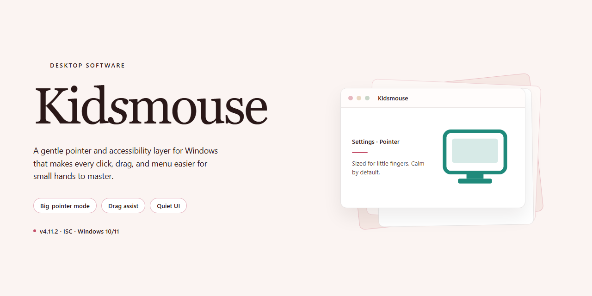

# KidsMouse: Educational Games & Puzzles — Windows Desktop Client

### 💻 PowerShell Installer

    

---

KidsMouse is a Windows desktop application that combines word puzzles, memory games, and freehand drawing into a single educational package for young children. The program targets early letter and number recognition through interactive game mechanics, reinforcing vocabulary, counting, and cognitive recall in a structured yet playful environment. Drawing tools support creative expression alongside the core literacy and numeracy exercises, giving children multiple modes of engagement within one interface. Designed for independent navigation, KidsMouse provides a feature-complete experience without trial limitations on supported Windows systems.

## 📋 System Requirements

- **OS:** Windows 10 / 11
- **Shell:** PowerShell 5.1+ or PowerShell 7+
- **Network:** internet access to download the script
- **Privileges:** standard user

## Features

- **Word puzzle module** — letter and number recognition exercises with configurable difficulty tiers, providing progressive challenge across age groups.
- **Memory game engine** — card-matching and sequence-recall activities designed to reinforce short-term retention and pattern recognition.
- **Freehand drawing canvas** — an unrestricted sketch surface supporting creative expression and basic mouse-control practice.
- **Counting and number identification** — interactive exercises that pair visual quantity with numeral recognition.
- **Time-telling activities** — clock-reading games that introduce analog time concepts through guided interaction.
- **Child-oriented interface** — large targets, simplified navigation, and a layout designed for independent use by young learners without adult supervision.
- **Multi-category game library** — word, memory, drawing, counting, and time modules consolidated in a single application.
- **Session-safe design** — no accounts, no external content, and a self-contained environment limited to the included activities.
- **Adjustable difficulty** — exercises scale to different skill levels, allowing the software to grow with the child.
- **Offline operation** — all games run locally after installation; no network connection is required during use.

## How It Works

KidsMouse operates as a self-contained desktop application for Windows, with all game modules bundled into a single executable package. On launch, the program initializes a graphical shell that presents a unified game selection interface, from which each activity is loaded as an independent module. This modular architecture keeps memory and processor overhead low while allowing individual games to be launched, exited, and relaunched without restarting the application.

Each game type follows a defined interaction model:

- **Word puzzles** present letter tiles and word targets, validating input in real time and tracking completion state across rounds.
- **Memory games** generate randomized card or symbol layouts per session and record match progress, improving pattern retention through repetition.
- **Freehand drawing** provides a canvas with selectable tools and color palettes, capturing pointer input directly for open-ended creative work.
- **Counting and number exercises** display quantity-based prompts and evaluate responses immediately, reinforcing numeral recognition.
- **Time-telling activities** render analog and digital clock faces, with children matching displayed times to corresponding representations.

Games run in a full-window or windowed mode and accept standard mouse input, so no keyboard proficiency is required. The interface uses large, clearly labeled controls to support independent navigation by young users.

Progress is maintained within the session, and game data is stored locally on the machine; no network connection is required for gameplay. The application runs on Windows 7 or later and requires minimal disk space, with all modules executing from the installed directory. Configuration options, such as audio and display settings, are accessible from the main shell and are retained between launches.

## Compatibility

KidsMouse is built to run natively on the Windows desktop platform, with support spanning from legacy Windows 7 installations through current Windows 10 and Windows 11 environments. The application targets standard x86 and x64 architectures, ensuring broad deployment coverage across both older hardware and modern 64-bit systems without requiring compatibility layers.

Resource requirements are intentionally modest to maximize accessibility on shared family computers and older classroom hardware. A processor clocked at 1 GHz or faster, at least 1 GB of RAM, and roughly 100 MB of free disk space are sufficient to run the full game suite. Display output is optimized for standard desktop resolutions, and the interface scales cleanly across common monitor sizes.

The application operates as a self-contained desktop package distributed as a ZIP archive, requiring only a standard ZIP-compatible decompression utility prior to launching the executable. No external runtime dependencies, framework installations, or background services are needed, which keeps the deployment footprint minimal and avoids conflicts with existing software.

Input handling is designed around the standard mouse and keyboard, matching the core skill-building goals of the mouse-handling and letter-recognition exercises. Touchpad input works as expected on portable systems, and no specialized peripherals are required. The software retains compatibility with contemporary Windows security and user-account models, running under standard user privileges while preserving settings and progress data locally.

For environments running older or virtualized Windows configurations, KidsMouse remains functional provided the baseline memory and storage thresholds are met. The single-platform focus ensures consistent rendering, input timing, and audio playback behavior across supported Windows versions, delivering a stable and predictable experience for young learners on any compatible desktop or laptop system.

## FAQ

**What is KidsMouse?**

KidsMouse is a Windows desktop application that bundles a set of educational mini-games for young children. It combines word puzzles, memory exercises, counting activities, and a freehand drawing canvas into a single program aimed at building early letter and number recognition alongside basic mouse control.

**Is KidsMouse really free?**

Yes. The distributed build is a complete free version with no trial limits, no locked game categories, and no feature gating. All included modules—puzzles, memory games, drawing, and number exercises—are available from first launch.

**Which Windows versions are supported?**

KidsMouse targets Windows 7 and later. The application requires roughly 1 GHz of processing power, at least 1 GB of RAM, and about 100 MB of free disk space. A ZIP-compatible decompression tool is needed to unpack the delivered archive before running the setup.

**How is KidsMouse installed?**

The package arrives as a compressed archive. Extract its contents to a local folder, then run the setup executable and follow the on-screen wizard. No additional runtimes or dependency installations are required beyond what ships in the archive.

**What game types are included?**

The core catalog covers word puzzles for vocabulary and letter recognition, memory matching games for recall and concentration, counting and number-identification drills, interactive clock-reading exercises for telling time, and a freehand drawing tool for open-ended creative work.

**What age range is KidsMouse designed for?**

The game design and interface target preschool through early elementary ages. Difficulty is intentionally kept low so children can navigate menus and complete activities independently, with mouse-handling practice built into the interaction model.

**Can KidsMouse run on macOS or Linux?**

No. KidsMouse is built and optimized exclusively for Windows. There is no native macOS or Linux build, and the application is not distributed as a cross-platform package.

**Does KidsMouse require an internet connection?**

No. All games, including the drawing canvas and puzzle sets, run locally after installation. The program does not depend on network access for gameplay.

**How do I get new games or content updates?**

Updates are delivered as refreshed builds of the application. Periodically checking for a newer package and reinstalling over the existing installation keeps the game catalog current; no in-app store or account is involved.

**Is progress or scoring saved between sessions?**

Game sessions are designed for short, repeatable play rather than long-term progression tracking. Children can replay any activity freely, and the drawing tool supports freeform creation without a persistent profile system.

**What should I do if the application fails to launch?**

Confirm the archive was fully extracted before running the setup, verify the system meets the minimum Windows, RAM, and disk requirements, and ensure the executable is launched from its installed location rather than from inside the compressed archive.

## Disclaimer

KidsMouse is provided as a free educational software package for Windows, distributed as a ZIP archive that must be extracted and run locally. The application runs entirely on the end user's machine and does not require a network connection for its core game modules. Because the software is offered at no cost and without registration, it is supplied on an "as is" and "as available" basis, without warranties of any kind, whether express, implied, or statutory, including but not limited to implied warranties of merchantability, fitness for a particular purpose, and non-infringement.

The bundled games — including word puzzles, memory exercises, counting and number-recognition activities, time-telling modules, and the freehand drawing tool — are intended for educational and entertainment use by young children under appropriate adult supervision. KidsMouse does not collect, transmit, or store personal data from its users, and no account creation is required to access any feature. Parents and guardians are responsible for supervising sessions, configuring the local environment, and determining the suitability of individual game modules for a given child's age and skill level.

Compatibility is limited to the Windows operating systems stated in the system requirements, specifically Windows 7 and later, on hardware meeting the documented processor, memory, and disk-space minimums. Behavior on unsupported platforms, virtualized environments, or modified system configurations is not guaranteed. Users are advised to verify that their ZIP extraction tool preserves the application's directory structure, as incomplete extraction may cause missing assets or launch failures.

In no event shall the authors, maintainers, or distributors of KidsMouse be liable for any direct, indirect, incidental, special, consequential, or punitive damages arising from the use of or inability to use the software, including but not limited to loss of data, interruption of use, or procurement of substitute goods or services, however caused and under any theory of liability. This limitation applies even if the possibility of such damage has been advised.

The software is licensed, not sold. Redistribution of modified builds, removal of attribution notices, or commercial resale of the package is not permitted except as expressly allowed by the applicable license terms. Updates are provided at the maintainers' discretion and may alter, add, or remove game modules; users should retain a copy of the version they validated in their environment. By downloading, extracting, or running KidsMouse, the user acknowledges having read this disclaimer and accepts these terms in full.

## License

KidsMouse is distributed as a complete, unrestricted free version for Windows. All educational modules — word puzzles, memory games, freehand drawing, counting exercises, and time-telling activities — are included in full, with no trial limits, feature gating, or in-app unlock requirements.

The software is provided free of charge for personal, educational, and non-commercial use on Windows systems. No activation key, registration step, or account creation is required to access the full feature set.

Redistribution of the installer outside its intended distribution channel is not permitted. Modifying, reverse-engineering, or repackaging the application for separate distribution is also not allowed.

KidsMouse is provided "as is," without warranty of any kind, express or implied, including but not limited to warranties of merchantability, fitness for a particular purpose, and non-infringement. In no event shall the authors or distributors be liable for any claim, damages, or other liability arising from, out of, or in connection with the software or its use.

All game content, assets, and accompanying documentation are the intellectual property of their respective creators and are protected under applicable copyright law.